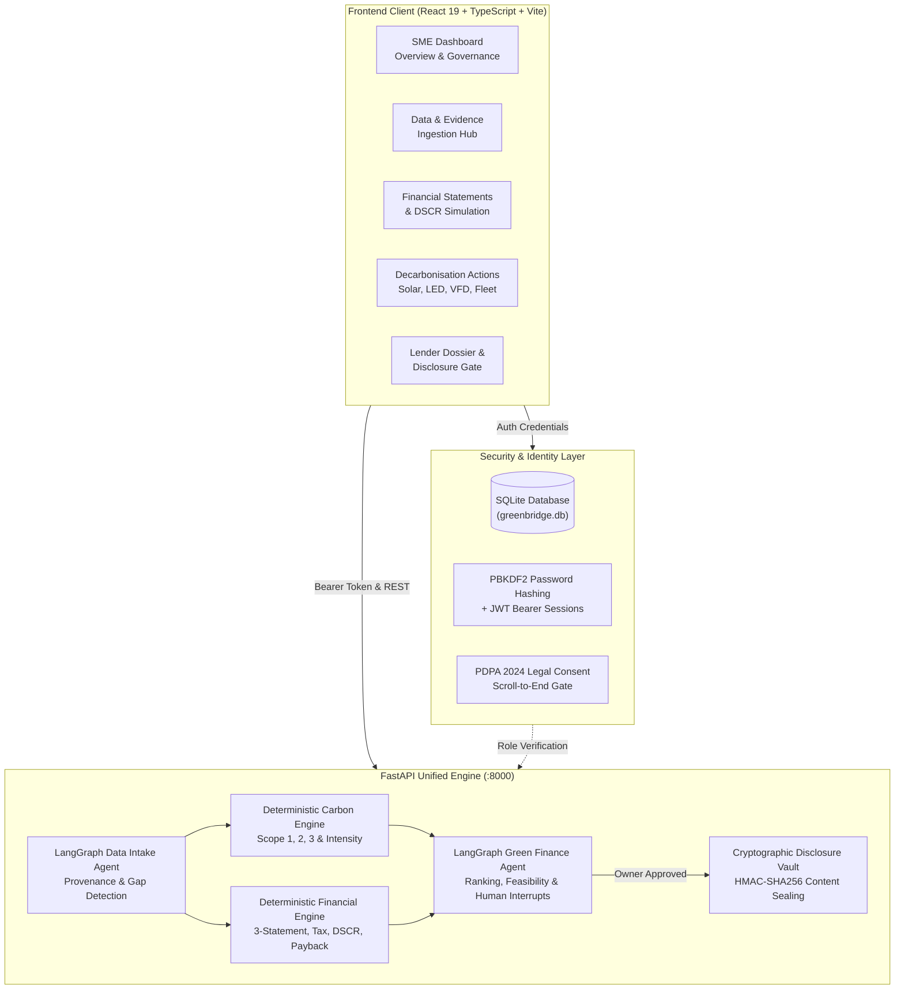

# GreenBridge — AI-Powered Green Finance Copilot for SMEs

[](https://fastapi.tiangolo.com)
[](https://react.dev)
[](https://www.typescriptlang.org)
[](https://langchain-ai.github.io/langgraph/)
[](https://python.org)
[](https://sqlite.org)
[](LICENSE)

> **TransitionAI / GreenBridge** empowers Small and Medium-Sized Enterprises (SMEs) to organize fragmented operational and financial records, establish verified carbon baselines, model financially viable decarbonisation pathways, and unlock concessionary transition financing under the **Bank Negara Malaysia (BNM) Low Carbon Transition Facility (LCTF)** and **Green Technology Financing Scheme (GTFS 4.0)**.

---

## 🌟 Executive Summary & Problem Statement

Small and Medium Enterprises (SMEs) contribute over 38% of Malaysia's GDP but face three critical bottlenecks in the green transition:

1. **Fragmented & Messy Data**: Utility bills, diesel receipts, bank statements, and production logs are scattered across PDFs, spreadsheets, and paper records.
2. **The "Green Math" Gap**: Calculating Scope 1, 2, and 3 emissions against regional grid factors while concurrently forecasting 3-statement cash flow and Debt Service Coverage Ratio (DSCR) requires expensive consultants.
3. **The Bankability Barrier**: Commercial lenders (Maybank, CIMB, RHB) require audit-proof evidence provenance and signed covenants before approving concessionary green loans.

**GreenBridge bridges this gap.** By combining **deterministic financial/carbon engines** with an **agentic LangGraph workflow**, GreenBridge guarantees zero numerical hallucination while providing SME owners with a trusted green copilot and an audit-sealed lender dossier.

---

## 🏛️ System Architecture

GreenBridge separates probabilistic reasoning (LLM explanations) from deterministic calculations (cash flows, tax tiers, emissions math, and cryptographic seals):



---

## 🚀 Core Pillars & Capabilities

### 1. 📂 Agentic Data Intake & Evidence Verification
* **Multi-Format Ingestion**: Ingests energy consumption records, industrial telemetry, TNB utility statements, fuel receipts, and 7-sheet standard SME financial models (Excel/CSV/PDF).
* **Provenance Tracking**: Every single data point retains an audit trail: source file, row, extraction method, confidence score, and timestamp.
* **State-Gated Readiness**: Categorizes data into `READY`, `PARTIAL`, or `BLOCKED`. Missing critical evidence pauses downstream work with clear, actionable requests rather than fabricating data.

### 2. ⚡ Deterministic Carbon Accounting Engine
* **ISO 14064 & GHG Protocol Alignment**:
  * **Scope 1**: Direct stationary combustion (natural gas, LPG) and mobile combustion (diesel fleet logs).
  * **Scope 2**: Location-based electricity calculations using Suruhanjaya Tenaga / Energy Commission emission factors (Peninsular Malaysia: `0.584 kgCO2e/kWh`, Sabah: `0.533`, Sarawak: `0.198`).
  * **Scope 3**: Supply chain, transportation, and industrial waste streams.
* **Carbon Intensity Metrics**: Computes $tCO_2e/\text{revenue}$ and $tCO_2e/\text{employee}$ benchmarks.

### 3. 💰 Deterministic Financial & Transition Engine
* **3-Statement Modeling**: Generates balanced Income Statements, Balance Sheets, and Cash Flow Statements.
* **Malaysian SME Corporate Tax**: Accurately computes statutory multi-tier SME tax brackets (15% on first RM 150k, 17% on next RM 450k, 24% on excess).
* **Debt Capacity & DSCR**: Calculates Cash Flow Available for Debt Service (CFADS) and verifies compliance against bank covenants ($\text{DSCR} \ge 1.25\times$).
* **Transition Interventions**: Dynamically sizes and evaluates:
  * Commercial Rooftop Solar PV (kWp sizing, feed-in offset, 25-yr degradation, NEM 3.0 SelCo)
  * Smart Industrial LED High-Bay Retrofit (efficacy upgrade, sensor daylight harvesting)
  * IE4 Motors & Variable Frequency Drives (VFD)
  * Commercial Fleet Electrification (EV vans, diesel displacement, charging infrastructure)

### 4. 🤖 AI Green Finance Copilot & Readiness Routing
* **LangGraph StateGraph**: Orchestrates SME goals (Carbon-First, Cash-Preservation, or Balanced) through deterministic constraint checks.
* **Human-in-the-Loop Interrupts**: Requires explicit human acceptance when operating with partial data or selecting capital-intensive transition pathways.
* **Zero Hallucination Guarantee**: LLMs (Google Gemini) are strictly restricted to qualitative commentary and natural language summaries. All figures, ratios, and projections are computed deterministically.

### 5. 🔐 Bank-Grade Lender Pack & Cryptographic Disclosure Boundary
* **SME Owner Exclusive Signatory**: Strict Role-Based Access Control (RBAC) ensures only authenticated Managing Directors (`sme_owner`) can approve external disclosure.
* **HMAC-SHA256 Tamper Sealing**: Completed financing packs are cryptographically sealed. Any unauthorized modification to financial or carbon figures immediately invalidates the package token.
* **Granular Disclosures**: SMEs control which modules (Carbon Baseline, Financial Summary, Evidence Documents) are visible to prospective lenders.

---

## 👥 Role-Based Access Control (RBAC) & Personas

| Feature / Capability | `sme_owner` (Managing Director) | `finance_manager` (Head of Accounts) | `lender` (Credit Analyst / Bank) |
| :--- | :---: | :---: | :---: |
| **Workspace Access** | Full Company Workspace | Full Company Workspace | Token-Scoped Portal Only |
| **Upload Bills & Bank Statements** | ✅ Yes | ✅ Yes | ❌ Denied |
| **Model Decarbonisation Actions** | ✅ Yes | ✅ Yes | ❌ Denied |
| **Draft Transition Plans** | ✅ Yes | ✅ Yes | ❌ Denied |
| **Approve & Sign Lender Disclosure** | 🔐 **Yes (Exclusive)** | ❌ Draft Only | ❌ Denied |
| **Review Shared Dossier by Token** | ✅ Yes | ✅ Yes | ✅ **Yes** |
| **View Audit Trail & Provenance** | ✅ Yes | ✅ Yes | 👁️ Read-Only (Disclosed items) |

---

## 🛠️ Tech Stack

* **Backend**: Python 3.11, FastAPI, Uvicorn, LangGraph, Pydantic v2, SQLite3, Google GenAI SDK
* **Frontend**: React 19, TypeScript, Vite, TailwindCSS, Motion, Lucide Icons
* **Data & Calculations**: OpenPyXL, Pandas, NumPy, Scikit-learn
* **Security & Auth**: PBKDF2 with SHA-256 (600,000 iterations), JWT (JSON Web Tokens), HMAC-SHA256 Content Sealing

---

## 📁 Repository Structure

```
GreenBridge/
├── backend/
│   ├── agent/                 # LangGraph Main Agent, constraints, ranking & financing
│   ├── auth/                  # SQLite DB init, PBKDF2 hashing, JWT & auth router
│   ├── carbon/                # Scope 1/2/3 emission calculations & carbon router
│   ├── data/                  # Ingestion parsers, mapping & LangGraph intake subgraph
│   ├── finance_transition/    # 3-statement financial engine, tax, cash budget & transition
│   ├── runtime/               # Production service container & dependency injection
│   ├── tests/                 # Comprehensive pytest test suite (47+ tests)
│   ├── greenbridge.db         # SQLite persistent database (seeded with demo accounts)
│   └── main.py                # Unified FastAPI application entrypoint
├── frontend/
│   ├── src/
│   │   ├── auth/              # AuthContext, session storage & route guards
│   │   ├── components/        # UI modules (Overview, Ingestion, Financial, Carbon, Actions, Copilot)
│   │   ├── context/           # React State Providers (TransitionContext, FinanceContext)
│   │   ├── services/          # API client bridges connecting to FastAPI
│   │   └── utils/             # Presentation formatters & deterministic math mirrors
│   ├── data/                  # Local runtime transition storage
│   ├── server.ts              # Frontend Express/Vite full-stack dev server
│   └── package.json           # Node.js dependencies & scripts
├── test_data/                 # Sample industrial datasets, bills, and Excel models
├── requirements.txt           # Python backend dependencies
└── README.md                  # Project documentation
```

---

## ⚡ Quick Start Guide

### Prerequisites
* **Python 3.11+** installed (`python --version`)
* **Node.js 18+** & `npm` installed (`node --version`)

---

### Step 1: Backend Setup & Launch

1. Open a terminal in the project root:
   ```powershell
   # Install required Python dependencies
   pip install -r requirements.txt
   ```

2. Start the FastAPI backend server:
   ```powershell
   cd backend
   python -m uvicorn main:app --reload --port 8000
   ```
   * The backend will initialize `greenbridge.db` and seed evaluator demo accounts automatically.
   * Verify server health at: [http://localhost:8000/health](http://localhost:8000/health)
   * Interactive Swagger API documentation: [http://localhost:8000/docs](http://localhost:8000/docs)

---

### Step 2: Frontend Setup & Launch

1. Open a second terminal:
   ```powershell
   cd frontend
   npm install
   ```

2. Start the Vite development server:
   ```powershell
   npm run dev
   ```

3. Open your browser and navigate to:
   ```
   http://localhost:3000 (or the port displayed in your terminal)
   ```

---

## 🧪 Evaluator & Demo Accounts

For hackathon judges and evaluators, the login screen includes **1-Click Quick-Fill Demo Presets**:

| Role | Email | Password | Persona & Authority |
| :--- | :--- | :--- | :--- |
| **SME Owner** | `owner@apex.com` | `ApexGreen2026!` | **Dato' Ir. Tan Beng Huat** — Managing Director & Authorized Signatory |
| **Finance Manager** | `finance@apex.com` | `ApexGreen2026!` | **Sarah Wong, CA** — Head of Accounts (Prepares models & drafts) |
| **New SME Sign-up** | *(Any valid email)* | *(6+ characters)* | Registers a clean workspace in `greenbridge.db` |

---

## 🧪 Running the Test Suite

GreenBridge enforces high code quality with comprehensive automated testing across all financial, carbon, and agent workflows.

### Run Backend Tests (Pytest)
```powershell
# Run the complete backend test suite
pytest -v

# Run specific domain test suites:
pytest backend/tests/test_auth_sqlite.py -v         # Authentication & RBAC
pytest backend/tests/test_carbon_integration.py -v  # Carbon Engine Integration
pytest backend/tests/test_main_agent.py -v          # LangGraph Agent Orchestrator
pytest backend/tests/test_currency.py -v            # Currency & Financial Integrity
```

### Run Frontend Typecheck
```powershell
cd frontend
npm run lint    # Runs tsc --noEmit to verify zero TypeScript errors
```

---

## 📜 Regulatory & Standards Alignment

* **Bank Negara Malaysia (BNM)**: Aligned with the *Climate Risk Management and Scenario Analysis (CRMA)* policy document and *Low Carbon Transition Facility (LCTF)* financing requirements.
* **Malaysian Green Technology and Climate Change Corporation (MGTC)**: Compatible with the *Green Technology Financing Scheme (GTFS 4.0)* eligibility criteria.
* **Personal Data Protection Act (PDPA 2024)**: Salted cryptographic password storage, audit attribution, affirmative legal consent gates, and role boundary separation.
* **GHG Protocol & Suruhanjaya Tenaga (ST)**: Grid-region specific emissions factors and NEM 3.0 / SelCo solar generation parameters.

---

## 👥 Contributors & Team

Built with passion for sustainable SME growth by **Team GreenBridge** for the AI Green Finance Hackathon 2026.