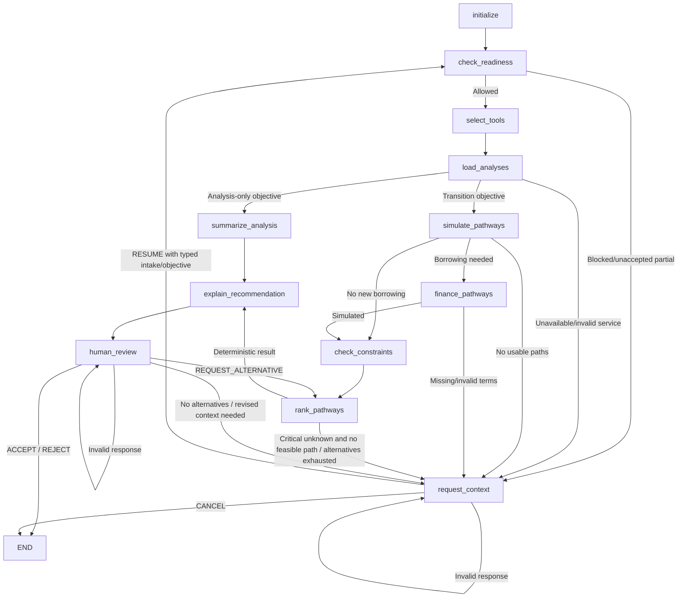

# GreenBridge Main Agent — Phase 1

This is a backend-only LangGraph orchestrator. Data Intake, frontend, Carbon,
Finance and Transition service files are unchanged. `lender_pack.py` remains
empty: no pack generation, lender submission, disclosure or external sharing is
available to this graph. SME acceptance is review of a pathway, not permission
to disclose or a lender's credit decision.

## Architecture and entry point

- `models.py`: Pydantic tool, objective, service, projection, ranking and review contracts.
- `state.py`: `MainAgentState`, containing JSON-compatible checkpoint dictionaries.
- `graph.py`: conditional orchestration, context/review interrupts and execution trace.
- `tools.py`: typed allowlist, replaceable service protocol, explicit fixture adapter,
  and ordered transition projections.
- `constraints.py`: deterministic PASS / FAIL / UNKNOWN checks.
- `ranking.py`: feasibility screening and stable, explicit ranking rules.
- `financing.py`: reconciled funding, monthly amortisation and company CFADS-based DSCR.
- `llm.py`: optional Gemini qualitative explanation and an opt-in narrow objective parser.

```python
from backend.agent import MainAgent, MainAgentInput, SMEObjective
from langgraph.types import Command

agent = MainAgent(services=your_services_adapter)
config = {"configurable": {"thread_id": "company-unique-intake-version"}, "recursion_limit": 150}
inputs = MainAgentInput(
    intake_result=validated_data_intake_result,
    objective=SMEObjective(
        focus="BALANCED",
        constraints={"carbon_reduction_target_pct": 30,
                     "minimum_cash_reserve": 200000,
                     "maximum_payback_years": 6},
        funding={"mode": "CASH_ONLY", "grant_amount": 0},
    ),
)
result = agent.invoke(inputs, config)
# JSON-ready result; active questions are in result['__interrupt__'].
result = agent.invoke(Command(resume={
    "actor": "SME Owner", "action": "ACCEPT", "reason": "Reviewed the projected pathway",
}), config)
```

`build_graph()` exposes the underlying LangGraph API. `MainAgent.invoke()` and
`ainvoke()` serialize interrupt payloads for future application use. No API
endpoints are added. Use the same thread for `Command(resume=...)`; a new input
invocation starts a fresh run. A durable saver can be injected as `checkpointer`.
The default in-memory saver does not persist across process restarts.

## State-dependent routing



`ASSESS_CARBON` calls only carbon analysis. `ASSESS_FINANCIAL` calls only finance.
`PLAN_TRANSITION` requires carbon, financial and transition readiness, retrieves
the relevant services/catalog, simulates permitted pathways, and calls financing
only for positive required principals. `action_ids` can constrain the catalog.
Individual paths are generated from actions if the service supplies no paths;
staged paths must be explicitly provided in the catalog, in execution order.

READY with published intake data permits a tool. PARTIAL requires the intake
contract's explicit acceptance and `may_proceed`; the graph preserves PARTIAL,
its reasons/gaps and projection limitations. BLOCKED never permits its tool.
The registry independently checks readiness for analysis calls. Unknown fields
remain None; unverified inputs are never silently replaced by zero or a sample.

## Tool contracts and adapter boundary

| Tool | Request | Result |
| --- | --- | --- |
| get_carbon_analysis | AnalysisRequest | CarbonToolResult / CarbonAnalysis |
| get_financial_analysis | AnalysisRequest | FinancialToolResult / FinancialAnalysis |
| get_transition_options | AnalysisRequest | TransitionOptionsResult / TransitionOptions |
| simulate_transition | TransitionRequest | PathwaySimulation |
| simulate_financing | FinancingRequest | FinancingSimulation |
| check_transition_constraints | ConstraintRequest | ConstraintResult |
| rank_transition_pathways | RankingRequest | RankingResult |

`AnalysisServices` has the three retrieval methods. The default
`UnavailableServices` returns explicit missing context. Connect teammates' real
services through this boundary; do not implement parallel production carbon or
financial engines in this package. Responses must match the intake company/year
and declare source, assumptions, limitations and SERVICE/TEST_DOUBLE origin.
Reported cash, debt service, CAPEX budget and reserve must agree with supplied
intake snapshot values when both are present; conflicts require reconciliation.

`FixtureServices` accepts caller-supplied Pydantic analysis/catalog fixtures and
marks them TEST_DOUBLE. There are no default Apex values or automatic sample
fallbacks. The offline test fixtures and saved example are demonstrations only.
Service adapter replacement does not change the graph's tool contracts.

CarbonAnalysis carries explicit disjoint impact groups, each with service-supplied
emissions and optional annual cost (MYR) context. These are analysis inputs, not
carbon/financial calculations performed by the agent. Units, region/factor
versions, tariffs, costs and feasibility evidence must be established by the
responsible service or declared assumption before returning those facts.

## Pathway, funding and constraints

An action declares CAPEX plus service-supplied emissions/cost reduction fractions
on a named disjoint impact group. LED followed by Solar applies Solar to the
residual group, not to the original standalone baseline. For example, a declared
ten-percent LED impact followed by a half-residual Solar impact reduces that
group by fifty-five percent, not sixty. Missing fractions/baselines propagate
None through subsequent effects. Group allocations cannot exceed the total
carbon baseline, and repeated action IDs are rejected.

Metrics represent steady-state after all stages, with all funding reserved
upfront. Stage order is modeled; construction timing, delayed savings, escalation,
tax and replacement schedules are not. Quotes and fractions remain projections.

Funding is explicit:

`CAPEX = SME contribution + grant + financing principal`

The grant must be declared, including explicit zero. CASH_ONLY uses SME funds
after the grant; FINANCE_IF_NEEDED uses cash above the stricter declared reserve,
subject to the SME contribution cap, and borrows the remainder. Rates and tenure
must be supplied when borrowing is needed. Input/range/funding checks reject
invalid values; no model or historical rate is used as a silent default.

Company post-financing DSCR is:

`(service-supplied baseline annual CFADS + incremental annual savings)
 / (existing annual debt service + new annual debt service)`

This is an explicitly documented projection assumption. CFADS must exclude the
new savings and be supplied by Finance; EBITDA is never substituted for it.
Missing inputs yield None and a warning. Zero total debt service yields None as
not applicable, not an invented ratio. Negative baseline CFADS is retained and
can produce a failing negative ratio. Display rounding belongs to presentation;
screening uses the unrounded deterministic values.

Critical checks include the cash reserve, CAPEX limit, reconciled funding,
positive net annual benefit, objective carbon target/positive carbon impact,
requested payback, SME contribution limit and financing burden/company DSCR as
applicable. UNKNOWN is not PASS. When no path passes and critical context is
unknown, the graph pauses for that context. Known failures can be reviewed but
cannot be ACCEPTed as a feasible recommendation.

Ranking requires all mandatory critical checks, rejects inconsistent/missing
checks and ranks feasible paths before others. CARBON prefers emissions reduction,
then net annual benefit and payback; COST prefers net annual benefit, payback and
carbon reduction; BALANCED prefers payback, carbon reduction and net annual
benefit. Lower CAPEX and ID are stable tie-breakers. These rules are returned
with the rankings. No Gemini output is an input to screening or ranking.

## LLM and human boundaries

Gemini is optional and receives detached structured results. Its role in Phase 1
is qualitative explanation only. No executable tools or approval APIs are attached.
The model must echo the selected pathway ID; another ID, extra decision fields,
numeric prose or invalid output triggers deterministic commentary fallback.
Narration cannot mutate readiness, rankings, financial results or selection.
All payload text, including company names and assumptions, is treated as untrusted
data rather than instructions. Semantic correctness of prose still needs review.

Keys come only from GEMINI_API_KEY/GOOGLE_API_KEY. GEMINI_MODEL is optional and
defaults to gemini-3.8-flash, following the existing project configuration pattern.
No credentials or provider error details are returned. Tests do not call Gemini.

`objective_from_text()` is an opt-in deterministic helper for the SME-entered
carbon/cash/payback example. Unsupported/contradictory thresholds raise instead
of being silently ignored. Richer goals use SMEObjective/SMEConstraints directly.
Uploaded document text is never passed to this helper or used to set tool names.
Tool selection in Phase 1 is a bounded deterministic policy in LangGraph.

Human review requires an external `Command(resume=...)` with actor, action and
reason: ACCEPT, REJECT or REQUEST_ALTERNATIVE. Alternative requests exclude the
current recommendation and rerank existing valid results without rerunning analysis.
Exhausted alternatives request revised context. No model can supply a decision
through its explanation schema. Acceptance records a timestamp and selected path,
but does not verify evidence, approve lending or authorize disclosure.

Context requests accept only a typed ContextResponse: actor, RESUME/CANCEL,
optional updated DataIntakeResult and optional updated SMEObjective. They cannot
inject numeric tool results. Resuming invalidates derived results and rechecks
readiness. Callers must authenticate/authorize human actors and company/thread
ownership; actor labels alone are not authentication. No resume HTTP endpoint is
implemented in this phase.

The trace records readiness, tool plans/calls/failures, pathway/financing simulation,
constraints, rankings, deterministic recommendations, explanation/fallback and
human review/decisions. Raw credentials and arbitrary executable instructions are
never trace fields.

## Validation and remaining work

Run the backend suite with root requirements installed:

```console
python -B -m unittest discover -s backend/tests -v
```

The existing Data Intake tests are unchanged. Main-agent tests use scoped service
fixtures and mocked Gemini. The [saved demo](examples/phase1_demo.json) is generated
from those explicit TEST_DOUBLE fixtures and real graph invocation/resume.

Phase 2 Lender Pack must add a deterministic, versioned DRAFT snapshot, projected
versus verified evidence labels, disclosure scope, owner approval/rejection bound
to an immutable content hash, authenticated authorization and approved-only access.
Pathway acceptance here must never substitute for disclosure approval. Persistent
checkpointing/service version freshness and integration endpoints also remain to
be wired. No actual sharing/submission belongs in Phase 1.
