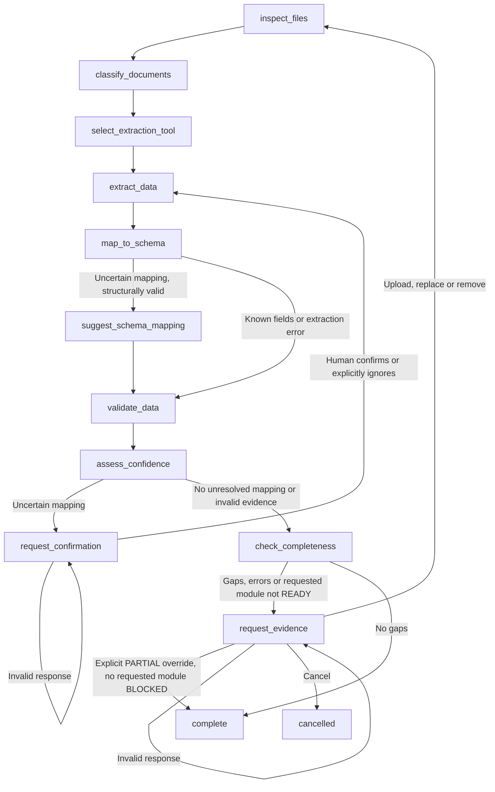

# GreenBridge AI Data Intake Agent

This is an optional backend-only LangGraph subgraph over the existing deterministic
`backend.data` parser and service. It adds no endpoints, UI, OCR, lending decisions,
or Carbon/Finance/Transition calculations. Importing `backend.data` alone does not
load LangGraph or Gemini. The current checkout's `backend/agent` files are empty;
the separate Gemini helper follows the frontend's environment-variable pattern.

## Public output contract

Use `DataIntakeAgent.invoke()` / `ainvoke()` for a typed `DataIntakeResult` on
both completion and pause. `get_result(config)` exports the current checkpoint
without advancing it. `build_intake_graph()` remains the lower-level state API;
`build_result(state)` adapts that state to the same public contract.

```python
from backend.data.intake import DataIntakeAgent, DataIntakeResult

agent = DataIntakeAgent()
result: DataIntakeResult = agent.invoke(inputs, config)
json_ready = result.model_dump(mode="json")
json_text = result.model_dump_json()
# A later FastAPI endpoint can use response_model=DataIntakeResult.
```

Required Pydantic fields:

```python
company: SMEMetadata
normalized_data: NormalizedDataset | None
evidence: list[ValueEvidence]
data_gaps: list[EvidenceGap]
readiness: dict[Module, ModuleReadiness]
agent_next_action: Literal["PROCEED", "REQUEST_EVIDENCE", "REQUEST_CONFIRMATION", "BLOCK"]
```

Also included: requested_modules, partial_acceptances (actor/reason/time/modules/
acknowledged gaps), mapping_requests, suggestions, errors, notices and intake_status.
No uploaded file bytes, provisional numeric values or private checkpoint internals
are included. While paused, normalized_data is null. Evidence entries are published
only after deterministic validation and acceptance; they include both original and
normalized values/units, source file/column/row/sheet, extraction/mapping methods,
confidence, source quality and confirmation status.

Each module reports status, reasons, partial_accepted and may_proceed. BLOCKED
cannot be overridden, even when its numeric inputs passed validation. READY can
proceed once data is published. PARTIAL pauses for evidence unless the human
explicitly accepts its gaps; it then retains PARTIAL with partial_accepted=true.
The actor, reason, UTC timestamp and exact acknowledged gaps are recorded.
New uploads reparse all evidence, reassess readiness and revoke prior partial
permissions. A blocked unrequested module remains blocked without preventing a
ready requested module from proceeding. There are still no downstream tool calls.

`PROCEED` requires published validated data and permission for every requested
module. `REQUEST_CONFIRMATION` exposes mapping questions, `REQUEST_EVIDENCE`
exposes nonblocking incompleteness, and `BLOCK` denies requested downstream work
until blocking evidence is supplied (or the intake is cancelled). BLOCK can still
have an active evidence interrupt: use the same thread to upload the missing data.

The schema validates these invariants and supports JSON round trips. See the full
[generated JSON schema](examples/result.schema.json) and [example result](examples/partial_result.json).

## Routing



`initialize` validates the input before inspection. AI is skipped when known
CSV/XLSX aliases and units suffice. It is also skipped for known labels whose
units alone need human confirmation and for malformed/invalid evidence. Fuzzy
matches below 0.98 require confirmation in the agent, even though the standalone
parser retains its existing 0.94 threshold. All uncertain fields must be resolved
or explicitly ignored; the agent never publishes only the convenient subset.

`validate_data` calls the existing normalization service, including its snapshot
conflict and activity-period protections. `complete` is the only node that sets
`dataset`. While interrupted, `dataset` is `None`; `candidate_dataset`, when
present, is private validated-but-incomplete state, not a published dataset.

## Calling and resuming

```python
from langgraph.types import Command
from backend.data.intake import build_intake_graph

workflow = build_intake_graph()
config = {"configurable": {"thread_id": "company-intake-unique-id"}, "recursion_limit": 100}
result = workflow.invoke({
    "uploads": [{
        "file_id": "utility-2024",
        "filename": "TNB_2024.csv",
        "content": b"company_id,reporting_year,Total Power Used,reporting_period\nDEMO,2024,266,2024",
    }],
    "requested_modules": ["carbon_analysis"],
}, config)

# Read result['__interrupt__'][0].value or workflow.get_state(config).
# Even a Gemini suggestion cannot populate the authoritative dataset.
request = result["pending_mappings"][0]
result = workflow.invoke(Command(resume={
    "actor": "SME Owner",
    "decisions": [{
        "request_id": request["request_id"],
        "action": "confirm",
        "mapped_field": "electricity_kwh",
        "unit": "MWh",  # Human confirms the ORIGINAL measurement unit.
    }],
}), config)

# The parser now deterministically normalizes 266 MWh to 266000 kWh.
# Other activity applicability or unknown quality causes a second, separate
# evidence interrupt. Missing company/year would BLOCK the override instead.
result = workflow.invoke(Command(resume={
    "actor": "SME Owner",
    "action": "continue_incomplete",
    "reason": "Review this partial baseline while remaining evidence is collected",
}), config)
assert result["status"] == "COMPLETE_PARTIAL"
assert result["dataset"]["activity"]["electricity_kwh"] == 266000
```

Mapping responses may contain several decisions at once. Use `action: "ignore"`
with just the request ID to explicitly exclude irrelevant fields. Confirmations
are scoped to file ID, sheet, original header/metric and row. They record actor,
timestamp and original unit, then reparse the original bytes. Human corrections
do not rewrite raw numeric values or override a declared source unit.

For more evidence, resume the evidence interrupt with:

```python
Command(resume={
    "actor": "SME Owner", "action": "upload", "reason": "Replace duplicate export",
    "remove_file_ids": ["old-file-id"],
    "uploads": [{"file_id": "new-file-id", "filename": "records.csv", "content": csv_bytes}],
})
```

Removing a file invalidates its mapping decisions. Existing IDs cannot be
silently replaced. Validation errors and duplicate/overlapping evidence cannot
be waived via `continue_incomplete`; BLOCKED readiness cannot be overridden either.
`action: "cancel"` ends without publication.
Invalid human payloads pause again with a controlled error. A fresh `invoke`
starts a fresh intake; always use `Command(resume=...)` on the same thread to resume.

The default saver is in memory; inject a persistent LangGraph checkpointer with
`build_intake_graph(checkpointer=...)` for persistence across process restarts.
Use distinct threads per company/intake and retain the original files in that
thread. The API/application must authenticate and authorize resume callers; an
actor string is an audit label, not authentication. Do not expose raw checkpoints
or accept arbitrary `Command(update=...)`/derived graph state from a client.

## Tools and AI boundary

- `inspect_file`: format, content hash, headers, metric labels and known fields.
- `classify_document`: content-first categories with explanations; filename-only
  classifications are explicitly LOW confidence. No match remains `unknown`.
- `parse_csv`, `parse_excel`: existing parser, including confirmed mappings.
- `suggest_schema_mapping`: optional Gemini suggestions for unresolved labels.
- `validate_units`, `validate_financial_data`: existing units/schema constraints.
- `detect_duplicate_evidence`: identical bytes and possible activity overlap.
- `check_reporting_period_coverage`: explicit annual/monthly evidence coverage.
- `assess_evidence_confidence`, `find_evidence_gaps`, `assess_readiness`.

Gemini receives only unresolved labels, observed unit strings and the allowed
schema, never uploaded bytes or raw numeric values. The system instruction
explicitly treats labels as untrusted data. There are no executable tools or
auto-approval APIs attached to Gemini. Strict output validation rejects unknown
fields, mismatched request IDs, extra values and `requires_confirmation=false`.
Even a well-formed but malicious semantic suggestion can only become a human
question. It cannot calculate, approve, verify sources or modify dataset values.
Prompt instructions are defense in depth; deterministic validation and mandatory
human authorization are the trust boundaries, not model obedience alone.

Credentials: `GEMINI_API_KEY` or `GOOGLE_API_KEY`; optional `GEMINI_MODEL`, default
`gemini-3.8-flash` (matching the current frontend pattern). The helper has a
15-second HTTP timeout. Missing credentials/SDK/provider failure/invalid output
produce unresolved questions and generic notices, with no provider error details
or secrets. Known CSV/XLSX processing continues without Gemini.

## Confidence, gaps and readiness

Mapping confidence (deterministic string similarity) and semantic confidence
(a model's proposed similarity) are separate from evidence quality. No source
quality percentage is invented. Human-confirmed mappings have no fabricated
confidence score; a prior AI score is retained separately when applicable.

Evidence quality: `DIRECT_MEASURED`, `INVOICE_DERIVED`, `ESTIMATED_PROXY`, `UNKNOWN`.
This is caller-declared with a required basis for non-UNKNOWN values, never
inferred from instructions inside an uploaded document or from a filename.
Every assessment has `externally_verified: false`. Mapping status separately
records deterministic acceptance, deterministic uncertainty, AI-mapped confirmed
or unconfirmed, and human-confirmed interpretation. Provenance extends the
existing source file, column/metric, raw value, units, row, sheet and period with
file ID, confirmation actor/time/status, quality basis and semantic confidence.

Structured gaps include missing company/year, missing financial fields, missing
energy/fuel data, uncertain activity applicability, incomplete monthly coverage,
unknown/estimated quality, duplicates/overlap and invalid evidence. Jan-Oct
monthly records produce explicit missing November/December periods. A dated
transaction is not automatically considered a complete month. An explicit annual
aggregate is accepted as annual coverage, without claiming it is externally verified.

Readiness for carbon, financial and transition analysis is `READY`, `PARTIAL` or
`BLOCKED`, with reasons. Required context is company ID and reporting year.
Carbon readiness considers activity presence, missing-category applicability,
period coverage and source quality; financial readiness considers the six
existing financial fields and source quality. Transition readiness depends on
both. READY means structured input readiness, not completed analysis or credit
approval. An explicit incomplete continuation never upgrades readiness.

## Tests and limitations

```console
python -m unittest discover -s backend/tests -v
```

All AI tests are offline with injected/mocked helpers. Existing deterministic
tests are preserved. Tests cover real interrupts, checkpoint reconstruction,
mapping/unit confirmation, duplicate replacement, zero versus missing, partial
coverage, malicious content, fail-closed AI output and source-quality separation.

Limits: CSV/XLSX only; no OCR or arbitrary multi-header statement extraction;
no source authentication or external verification; no durable saver configured
by default; evidence quality currently declared per file; confirmations are
scoped per row/sheet rather than bulk auto-approval. Known annual/monthly parser
aggregation constraints remain unchanged. No external disclosure, frontend wiring
or downstream analysis is implemented.
